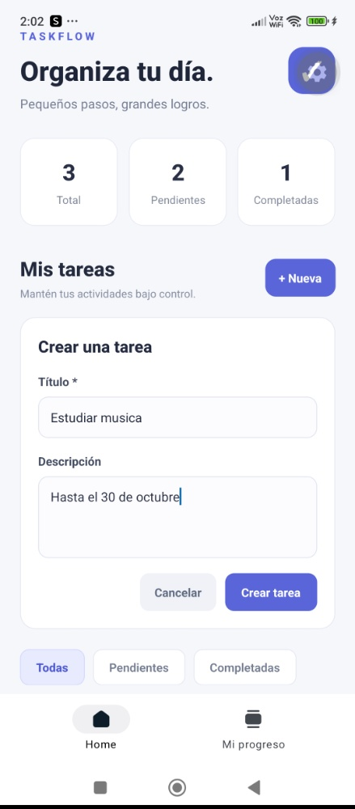
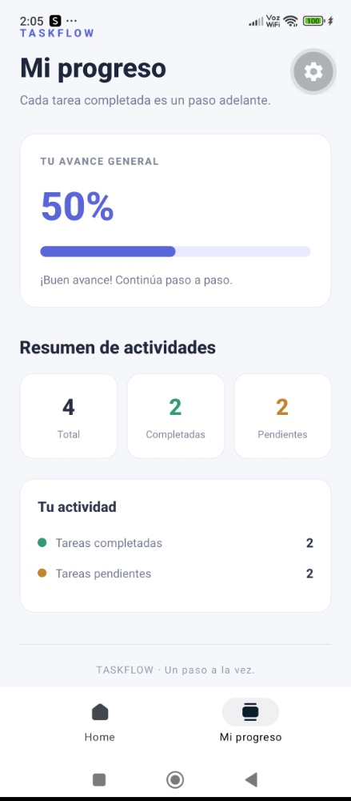
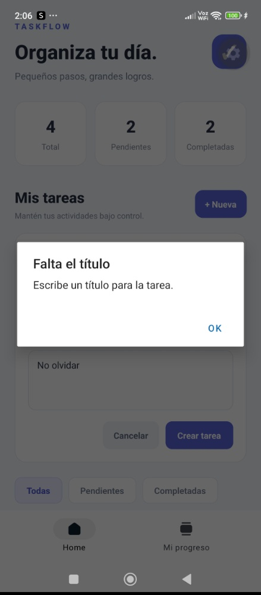

# TaskFlow

## Aplicación móvil para la gestión de tareas

TaskFlow es una aplicación móvil de tipo To-Do List desarrollada con React Native, Expo y TypeScript. Permite organizar tareas personales, controlar su estado y consultar el progreso de las actividades desde una interfaz sencilla.

## 1. Descripción del proyecto

La aplicación permite registrar actividades, modificar su información, eliminarlas y marcar las tareas como completadas. También incluye filtros para organizar las tareas y una pantalla que presenta estadísticas del progreso.

Cada tarea contiene los siguientes datos:

- **Identificador:** permite distinguir una tarea de otra.
- **Título:** indica el nombre de la actividad.
- **Descripción:** proporciona información adicional sobre la tarea.
- **Estado:** indica si la tarea está pendiente o completada.

## 2. Objetivos

### 2.1. Objetivo general

Desarrollar una aplicación móvil para gestionar tareas personales, aplicando conceptos fundamentales de programación móvil, componentes de interfaz, navegación y almacenamiento de información.

### 2.2. Objetivos específicos

- Comprender la estructura de un proyecto desarrollado con React Native y Expo.
- Implementar una interfaz organizada e intuitiva.
- Crear funcionalidades para registrar, consultar, editar y eliminar tareas.
- Incorporar opciones para cambiar el estado y filtrar las tareas.
- Utilizar almacenamiento local para conservar la información.
- Aplicar componentes y herramientas de React para organizar el código.
- Realizar pruebas funcionales para comprobar el comportamiento de la aplicación.

## 3. Tecnologías y herramientas utilizadas

| Tecnología o herramienta | Uso en el proyecto                                              |
| ------------------------ | --------------------------------------------------------------- |
| React Native             | Desarrollo de las pantallas y componentes de la interfaz móvil. |
| Expo                     | Configuración, ejecución y pruebas de la aplicación.            |
| Expo Router              | Organización de la navegación mediante archivos y rutas.        |
| TypeScript               | Definición de tipos de datos y estructura de las tareas.        |
| Node.js                  | Entorno utilizado para ejecutar herramientas de desarrollo.     |
| npm                      | Instalación y administración de dependencias.                   |
| AsyncStorage             | Almacenamiento local de las tareas en el dispositivo.           |
| Visual Studio Code       | Editor utilizado para desarrollar el proyecto.                  |
| Git y GitHub             | Control de versiones y publicación del código fuente.           |

### 3.1. Justificación de las tecnologías

React Native permite construir interfaces móviles mediante componentes reutilizables. Expo facilita la configuración y las pruebas en dispositivos móviles, mientras que TypeScript ayuda a mantener una estructura consistente en los datos.

AsyncStorage se utiliza para conservar las tareas sin necesitar una base de datos externa ni un servidor. La información se guarda localmente en el dispositivo.

El proyecto utiliza React Native con Expo y no Ionic, de acuerdo con las indicaciones de la evaluación.

## 4. Arquitectura y estructura del proyecto

TaskFlow utiliza una organización basada en componentes. La navegación entre pantallas se administra mediante Expo Router.

La estructura principal del proyecto es la siguiente:

```text
TaskFlow/
├── assets/
│   ├── fonts/
│   └── images/
├── src/
│   ├── app/
│   │   ├── _layout.tsx
│   │   ├── index.tsx
│   │   └── explore.tsx
│   ├── components/
│   │   ├── app-tabs.tsx
│   │   └── app-tabs.web.tsx
│   └── hooks/
│       └── use-theme.ts
├── package.json
├── package-lock.json
├── tsconfig.json
└── README.md
```

### 4.1. Descripción de las carpetas y archivos

- `src/app/index.tsx`: contiene la pantalla principal, donde se pueden crear, visualizar, editar, eliminar y completar tareas.
- `src/app/explore.tsx`: contiene la pantalla Mi progreso, que muestra estadísticas de las actividades.
- `src/app/_layout.tsx`: configura la estructura general de navegación y el tema de la aplicación.
- `src/components/`: contiene componentes relacionados con la navegación por pestañas.
- `src/hooks/use-theme.ts`: contiene lógica relacionada con el tema visual.
- `assets/`: almacena recursos gráficos y otros elementos utilizados por la aplicación.
- `package.json`: contiene información del proyecto y sus dependencias.
- `tsconfig.json`: define la configuración de TypeScript.

Esta organización permite identificar dónde se encuentra cada funcionalidad y facilita realizar modificaciones a medida que se incorporan nuevas características.

## 5. Patrones de diseño y organización del código

TaskFlow utiliza una organización basada en componentes, característica de React Native, que permite separar las funcionalidades y mantener el código ordenado.

Entre los principales enfoques utilizados se encuentran:

- **Arquitectura basada en componentes:** permite organizar la interfaz en elementos con funciones específicas.
- **Hooks de React:** permiten gestionar el estado y ejecutar efectos relacionados con el funcionamiento de las pantallas.
- **Navegación basada en archivos:** Expo Router organiza las pantallas mediante los archivos ubicados en `src/app`.

Por ejemplo, `index.tsx` contiene las funcionalidades para administrar tareas, mientras que `explore.tsx` presenta las estadísticas de progreso. Esta separación facilita la comprensión y modificación del código.

## 6. Diseño de la interfaz

TaskFlow presenta una interfaz de tonos claros, con tarjetas blancas, textos oscuros y elementos destacados en azul y morado. Su diseño busca mantener una apariencia ordenada y facilitar la navegación entre las funciones.

Se aplican los siguientes principios de diseño:

- **Jerarquía visual:** los títulos, las estadísticas y las tareas se distinguen mediante diferentes tamaños de texto.
- **Contraste:** los colores y las tarjetas ayudan a diferenciar la información y las acciones disponibles.
- **Organización y equilibrio:** los elementos se distribuyen en secciones, separando la gestión de tareas de las estadísticas de progreso.
- **Facilidad de uso:** los botones para crear, editar y eliminar tareas, los filtros y la navegación por pestañas permiten acceder a las funciones principales de forma directa.

La pantalla principal permite administrar las tareas, mientras que Mi progreso muestra el porcentaje de avance y el resumen de actividades completadas y pendientes.

## 7. Componentes de la interfaz

TaskFlow incorpora distintos componentes que permiten al usuario interactuar con la aplicación:

- **Formularios:** permiten ingresar los datos de una tarea y modificarlos posteriormente.
- **Botones:** permiten ejecutar acciones como guardar, editar, completar y eliminar tareas.
- **Listas:** muestran las tareas registradas y su estado.
- **Filtros:** permiten visualizar todas las tareas, las pendientes o las completadas.
- **Navegación por pestañas:** permite cambiar entre la lista de tareas y la pantalla de progreso.
- **Barra de progreso:** representa visualmente el porcentaje de tareas completadas.

La combinación de estos componentes permite administrar las tareas y consultar el avance desde una interfaz común.

## 8. Funcionalidades implementadas

TaskFlow permite administrar tareas personales mediante las siguientes funciones:

- Crear y consultar tareas.
- Editar y eliminar tareas.
- Marcar tareas como completadas.
- Filtrar tareas según su estado.
- Consultar estadísticas de progreso.
- Guardar las tareas localmente mediante AsyncStorage.

Además, se valida que el título no esté vacío antes de guardar una tarea, evitando registrar información sin el dato principal requerido.

### 8.1. Almacenamiento local

Las tareas se guardan mediante AsyncStorage utilizando la siguiente clave:

```text
@taskflow/tareas
```

La información permanece guardada al cerrar y volver a abrir la aplicación en el mismo dispositivo. Esta implementación no incluye sincronización automática entre dispositivos.

## 9. Pruebas y resultados

Se realizaron pruebas en un dispositivo móvil utilizando Expo Go para comprobar el funcionamiento de las principales características de TaskFlow.

| Prueba realizada                      | Resultado                      |
| ------------------------------------- | ------------------------------ |
| Crear una tarea                       | Correcto                       |
| Editar una tarea                      | Correcto                       |
| Eliminar una tarea                    | Correcto                       |
| Marcar una tarea como completada      | Correcto                       |
| Filtrar tareas por estado             | Correcto                       |
| Intentar guardar una tarea sin título | Se impide el registro          |
| Cerrar y volver a abrir la aplicación | Las tareas se conservan        |
| Consultar el progreso                 | Las estadísticas se actualizan |

También se verificó el proyecto mediante TypeScript y Expo Doctor. Este último completó sus 20 comprobaciones correctamente.

Los resultados permitieron comprobar el funcionamiento de las características evaluadas.

## 10. Evidencias de funcionamiento

A continuación, se presentan capturas de pantalla que permiten observar la interfaz y las principales funcionalidades implementadas en TaskFlow.

### Figura 1. Pantalla principal Home

Muestra la lista de tareas, los filtros disponibles y las acciones para administrarlas.


### Figura 2. Creación o edición de tareas

Muestra el formulario utilizado para ingresar o modificar la información de una tarea.



### Figura 3. Pantalla Mi progreso

Muestra el total de tareas, las actividades completadas y pendientes, y la barra de progreso.



### Figura 4. Validación de datos

Muestra cómo la aplicación impide guardar una tarea cuando el título está vacío.



**Nota:** las rutas de las imágenes son ejemplos. Deben coincidir con los nombres y las ubicaciones reales de las capturas que se suban al repositorio.

## 11. Video de demostración

El video mostrará el funcionamiento de TaskFlow, incluyendo la creación, edición y eliminación de tareas, el uso de los filtros y la consulta de las estadísticas de progreso.

**Enlace al video:** pendiente de agregar.

## 12. Uso de herramientas de inteligencia artificial

Durante el desarrollo se utilizaron herramientas de inteligencia artificial como apoyo para resolver dudas, comprender conceptos y orientar la implementación de funcionalidades.

El código se probó durante el desarrollo para comprobar que las funciones implementadas trabajaran correctamente.

## 13. Mejoras futuras

Como posibles mejoras, se propone incorporar fechas de vencimiento, categorías para organizar las tareas y notificaciones para recordar actividades pendientes.

Estas funciones podrían ampliar las posibilidades de organización de TaskFlow en futuras versiones.

## 14. Conclusión

El desarrollo de TaskFlow permitió aplicar conocimientos de programación móvil utilizando React Native, Expo y TypeScript.

La aplicación incorpora las principales operaciones de gestión de tareas, almacenamiento local y seguimiento del progreso. Las pruebas realizadas permitieron verificar el funcionamiento de estas características y comprobar que la información registrada se conserva al volver a abrir la aplicación.

Este proyecto permitió poner en práctica conceptos de desarrollo de interfaces, organización del código, navegación y almacenamiento de datos en una aplicación móvil.

## 15. Repositorio del proyecto

Código fuente de TaskFlow:

[https://github.com/alexandran-debug/TaskFlow](https://github.com/alexandran-debug/TaskFlow)
